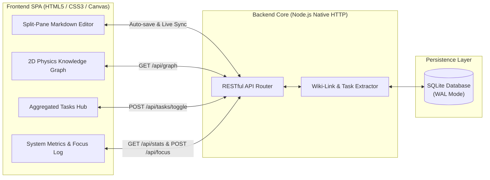

<div align="center">

# MindVault — Second Brain & Knowledge Graph OS

**Hệ thống Quản trị Tri thức Cá nhân (Zettelkasten), Soạn thảo Markdown Hai chiều & Đồ thị Vật lý Tương tác**

[](https://nodejs.org/)
[](https://www.sqlite.org/)
[](#)
[](https://opensource.org/licenses/MIT)

*Được thiết kế & phát triển bởi [Quốc Tuấn (@quoctuan364)](https://github.com/quoctuan364)*

</div>

---

## Điểm nổi bật (Key Highlights)

**MindVault** kết hợp sức mạnh của **Obsidian** (liên kết tri thức hai chiều `[[Wiki-Links]]` & Đồ thị Force-Directed), **Notion** (quản lý thư mục, mẫu tài liệu kỹ thuật) và **Deep Work Suite** (đồng hồ Pomodoro & trích xuất nhiệm vụ tự động) trong một kiến trúc **Full-Stack siêu nhẹ**:

- **Interactive 2D Force-Directed Knowledge Graph**: Mô phỏng vật lý thời gian thực (lực đẩy Coulomb + lực lò xo Hooke) trên HTML5 Canvas, hỗ trợ kéo thả nút, thu phóng, lọc liên kết và nhấp để mở bài viết.
- **Bi-directional `[[Wiki-Links]]` & Automatic Backlinks**: Gõ `[[Tên Tài Liệu]]` ở bất kỳ đâu để tạo liên kết hai chiều. Nếu tài liệu đích chưa tồn tại, nhấp vào link sẽ tự động khởi tạo tài liệu mới và nối vào mạng lưới.
- **Split-Pane Live Markdown Editor**: Soạn thảo song song với chế độ xem trước thời gian thực, hỗ trợ bảng biểu, khối lệnh, trích dẫn, thẻ `#tags` và thanh công cụ định dạng nhanh.
- **Aggregated Action Tasks Hub**: Tự động quét và gom toàn bộ các dòng nhiệm vụ `- [ ]` và `- [x]` từ mọi tài liệu về một bảng điều khiển trung tâm. Đánh dấu hoàn thành ở bất cứ đâu sẽ đồng bộ ngược vào cơ sở dữ liệu SQLite.
- **Built-in Focus Timer & System Metrics**: Đồng hồ tập trung 25 phút tích hợp sẵn trên thanh công cụ, tự động ghi nhận lịch sử phiên làm việc sâu vào SQLite và thống kê mật độ tri thức.
- **Zero-Dependency Native Architecture**: Vận hành hoàn toàn trên `node:http` và `node:sqlite` (WAL Mode) tích hợp sẵn trong Node.js hiện đại — khởi động dưới **30ms**, không cần cài đặt hàng trăm MB `node_modules`.

---

## Kiến trúc Hệ thống (System Architecture)



---

## Hướng dẫn Khởi chạy Nhanh (Quick Start)

### Yêu cầu hệ thống
- **Node.js** phiên bản `>= 22.5.0` (hoặc `v24+` có tích hợp sẵn mô-đun `node:sqlite`).

### Cài đặt & Chạy ứng dụng

```bash
# 1. Clone kho lưu trữ từ GitHub
git clone https://github.com/quoctuan364/mindvault.git
cd mindvault

# 2. Khởi chạy trực tiếp (Zero npm install)
node server/index.js
```

Hoặc trên Windows chỉ cần nhấp đúp vào file **`start-mindvault.bat`**.

Sau khi khởi động, mở trình duyệt tại:
`http://localhost:4321`

---

## Đặc tả RESTful API (API Endpoints)

| Phương thức | Endpoint | Mô tả chức năng |
| :--- | :--- | :--- |
| `GET` | `/api/notes` | Lấy danh sách tài liệu (hỗ trợ lọc theo `?q=`, `?folder=`, `?tag=`, `?favorite=true`) |
| `POST` | `/api/notes` | Tạo tài liệu mới và tự động tính toán số từ, trích xuất `[[Wiki-Links]]` |
| `GET` | `/api/notes/:id` | Lấy chi tiết tài liệu kèm danh sách `outgoingLinks` và `backlinks` |
| `PUT` | `/api/notes/:id` | Cập nhật nội dung, tiêu đề, thư mục, màu sắc, ghim hoặc đánh dấu |
| `DELETE` | `/api/notes/:id` | Xóa tài liệu khỏi kho tri thức |
| `POST` | `/api/tasks/toggle` | Đảo trạng thái hoàn thành `[ ]` ↔ `[x]` của nhiệm vụ ngay trong dòng Markdown |
| `GET` | `/api/graph` | Trả về cấu trúc đỉnh (`nodes`) và cạnh nối (`edges`) cho Đồ thị Tri thức |
| `GET` | `/api/stats` | Thống kê toàn diện kho tri thức, phân bổ `#tags`, thư mục và lịch sử Focus |
| `POST` | `/api/focus` | Lưu phiên làm việc sâu (Focus Session) vào SQLite |
| `GET` | `/api/export` | Xuất toàn bộ kho dữ liệu MindVault ra định dạng chuẩn JSON |

---

## Cấu trúc Thư mục (Project Structure)

```text
mindvault/
├── data/
│   └── mindvault.sqlite      # Cơ sở dữ liệu SQLite (tự động khởi tạo & nạp dữ liệu mẫu)
├── public/
│   ├── index.html            # Giao diện chính của ứng dụng (SPA)
│   ├── styles.css            # Hệ thống giao diện Dark Mode chuẩn kỹ thuật
│   └── app.js                # Logic Frontend, Markdown Parser & 2D Physics Graph Engine
├── server/
│   ├── db.js                 # Khởi tạo SQLite WAL, trích xuất Wiki-Links & Seed Data
│   └── index.js              # HTTP Server & RESTful API Endpoints
├── start-mindvault.bat       # Script khởi chạy nhanh 1-click trên Windows
├── package.json              # Thông tin cấu hình dự án
└── README.md                 # Tài liệu hướng dẫn chi tiết
```

---

## Phím tắt Tiện ích (Shortcuts)

- `Ctrl + K`: Mở bảng điều khiển tìm kiếm & chuyển nhanh tài liệu (**Command Palette**).
- `ESC`: Đóng nhanh cửa sổ modal hoặc bảng chọn nhãn.
- Cú pháp `[[Tên bài viết]]`: Tạo liên kết hai chiều giữa các tài liệu.
- Cú pháp `- [ ] Nội dung`: Tạo nhiệm vụ tự động đồng bộ sang **Action Tasks Hub**.

---

## Giấy phép (License)

Dự án được phân phối dưới giấy phép **MIT License**. Phát triển bởi **[Quốc Tuấn (@quoctuan364)](https://github.com/quoctuan364)**.
