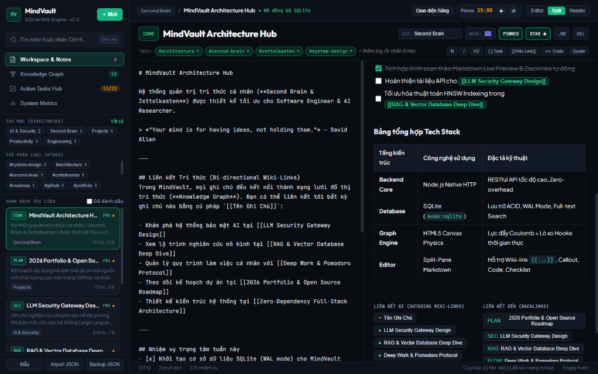
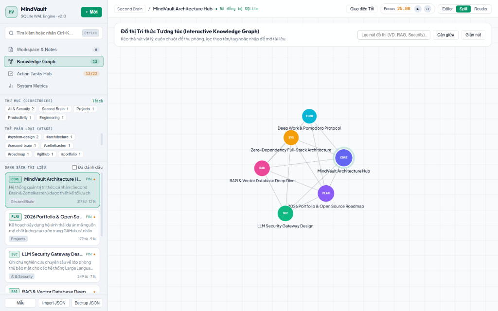

# MindVault v2.0 — Second Brain & Interactive Knowledge Graph OS

[](https://quoctuan364.github.io/mindvault/)
[](https://github.com/quoctuan364/mindvault)

**MindVault** là hệ thống quản trị tri thức cá nhân (**Second Brain · Zettelkasten**) viết hoàn toàn bằng **JavaScript thuần + Node.js (`node:sqlite` WAL)** không phụ thuộc thư viện ngoài (`0 npm dependencies`).

> **Dùng thử trực tuyến (không cần cài đặt):** https://quoctuan364.github.io/mindvault/

### Giao diện thực tế (Obsidian Dark Editor & Editorial Light Knowledge Graph)





Phiên bản **v2.0** nâng cấp kiến trúc **Hybrid Engine** — tự động nhận diện môi trường chạy:
1. **Desktop / Local Server Mode (`Node.js + SQLite WAL`):** Đồng bộ toàn bộ ghi chú, backlinks và lịch sử Pomodoro xuống cơ sở dữ liệu `data/mindvault.sqlite`.
2. **GitHub Pages / Browser Live Demo (`./local-engine.js`):** Khi mở tĩnh qua `docs/` trên GitHub Pages hoặc mở trực tiếp bằng trình duyệt không có backend, MindVault tự kích hoạt REST Engine chạy ngay trên `localStorage` kèm dữ liệu mẫu 6 tài liệu kỹ thuật và nút **Reset Demo**.

---

## Tính năng nổi bật (v2.0)

- **Kiến trúc Obsidian Dark & Editorial Light Theme:** Giao diện tương phản cao (`#090C11` Obsidian + `#10B981` Emerald + `#F59E0B` Amber), chuyển đổi nhanh Sáng/Tối ở thanh Topbar và đồng bộ màu trực tiếp trên Canvas Đồ thị Tri thức.
- **Split-Pane Markdown Editor & Bi-directional Wiki-Links:** Hỗ trợ gõ `[[Tên Tài Liệu]]` để liên kết hai chiều (nhấp để mở hoặc khởi tạo tài liệu mới nếu chưa tồn tại), hỗ trợ bảng Markdown, code block, checkbox tương tác.
- **Đồ thị Tri thức Vật lý 2D (`Interactive Knowledge Graph`):** Mô phỏng lực hút/đẩy Coulomb-Spring thời gian thực, hỗ trợ kéo thả nút, thu phóng theo con trỏ, lọc trực tiếp theo từ khóa (`#graphSearchInput`) và làm nổi bật các nút liên quan.
- **Action Tasks Hub & Focus Metrics:** Tự động thu thập toàn bộ checkbox `- [ ]` / `- [x]` từ mọi tài liệu, đồng bộ hai chiều với trình soạn thảo, tích hợp bộ đếm **Pomodoro 25:00** và thống kê mật độ liên kết Zettelkasten.
- **Import / Export JSON Backup & `.MD`:** Sao lưu toàn bộ kho tri thức ra JSON, phục hồi/gộp dữ liệu bằng `Import JSON` (giao dịch SQLite an toàn hoặc `localStorage`), hoặc tải từng bài dưới dạng `.md`.
- **Responsive Mobile Drawer & Command Palette (`Ctrl+K`):** Hỗ trợ đầy đủ trên màn hình nhỏ (`< 960px`) qua menu trượt và tìm kiếm nhanh bằng phím tắt.

---

## Cấu trúc thư mục

```text
mindvault/
├── server/
│   ├── db.js              # Khởi tạo node:sqlite WAL + seed 6 ghi chú kỹ thuật
│   └── index.js           # HTTP server thuần + REST API (/api/notes, /api/graph, /api/import, ...)
├── public/                # Frontend dùng chung cho Server mode
│   ├── index.html
│   ├── styles.css
│   ├── local-engine.js    # Engine giả lập 100% REST API trên localStorage
│   └── app.js             # Hybrid controller + Markdown parser + 2D Graph Engine
├── docs/                  # Bản mirror tĩnh sẵn sàng bật GitHub Pages (/docs)
├── start-mindvault.bat    # Khởi chạy nhanh 1-click trên Windows
└── package.json           # Yêu cầu Node >= 22.5.0 (built-in node:sqlite)
```

---

## Khởi chạy nhanh trên máy

### Cách 1: Click đúp `start-mindvault.bat` (Windows)
Trình khởi chạy tự tìm `Node.js` (hoặc runtime tích hợp), mở server tại `http://localhost:4321` và tự mở trình duyệt.

### Cách 2: Chạy bằng Node CLI (`>= 22.5.0`)
```bash
node server/index.js
```
Mở `http://localhost:4321` trên trình duyệt.

### Cách 3: Live Demo tĩnh (GitHub Pages `/docs`)
Bật **GitHub Pages → Deploy from branch → Folder `/docs`** để sử dụng toàn bộ tính năng chỉnh sửa, Knowledge Graph, Import/Export JSON ngay trên trình duyệt mà không cần backend.
